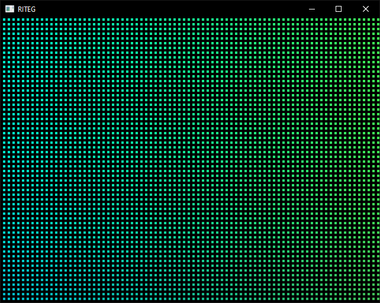

# RITEG.V2 projects

Unlike V1's JSON and initial V2's TOML, the new V2 (or V25) uses a more programmer-friendly approach and runs as a minimal Lua runtime.  
A project is a directed acyclic graph of shader nodes. The host compiles it into a flat render plan before the first frame, so the order in which nodes are created and wired does not matter.

## Example project
```lua
-- This shader is directly copypasted from a new shader
-- page on Shadertoy: https://www.shadertoy.com/new
local example = riteg.node(riteg.program([[
    void mainImage(out vec4 fragColor, in vec2 fragCoord)
    {
        // Normalized pixel coordinates (from 0 to 1)
        vec2 uv = fragCoord / iResolution.xy;

        // Time varying pixel color
        vec3 col = 0.5 + 0.5 * cos(iTime + uv.xyx + vec3(0.0, 2.0, 4.0));

        // Output to screen
        fragColor = vec4(col, 1.0);
    }
]]), 640, 480)

example:input(0, riteg.get_image_source())

-- This shader is directly copypasted from my Shadertoy
-- account: https://www.shadertoy.com/view/4cf3W8
local pixelize = riteg.node(riteg.program([[
    #define BLOCK_WIDTH     8.0
    #define BLOCK_HEIGHT    8.0
    #define SIZE_RATIO_X    0.5
    #define SIZE_RATIO_Y    0.5

    #define BACKGROUND vec4(0.0, 0.0, 0.0, 0.0)

    void mainImage(out vec4 fragColor, in vec2 fragCoord)
    {
        vec2 pixel = 1.0 / iResolution.xy;

        vec2 uv = vec2(0.0, 0.0);
        uv.x = BLOCK_WIDTH * pixel.x * floor(fragCoord.x / BLOCK_WIDTH);
        uv.y = BLOCK_HEIGHT * pixel.y * floor(fragCoord.y / BLOCK_HEIGHT);

        float gap_width = BLOCK_WIDTH * (1.0 - SIZE_RATIO_X);
        float gap_height = BLOCK_HEIGHT * (1.0 - SIZE_RATIO_Y);
        
        float mod_x = mod(fragCoord.x, BLOCK_WIDTH);
        float mod_y = mod(fragCoord.y, BLOCK_HEIGHT);

        vec4 color = vec4(0.0, 0.0, 0.0, 0.0);
        for(float i = 0.0; i < BLOCK_WIDTH; i += 1.0)
        for(float j = 0.0; j < BLOCK_HEIGHT; j += 1.0)
            color += texture(iChannel0, uv + pixel * vec2(i, j));
        color /= BLOCK_WIDTH * BLOCK_HEIGHT;

        if((mod_x <= gap_width) || (mod_y <= gap_height))
            fragColor = BACKGROUND;
        else fragColor = color;
    }
]]), 640, 480)

pixelize:input(0, example)

riteg.display(pixelize)
```

## Running the project
```
riteg project/example.lua
```

  

## Lua API

### Programs and nodes
- `riteg.program(source[, options])` Compiles a Shadertoy-style GLSL source and returns a reusable program handle. The same source string is compiled only once. `options.name` is optional.
- `riteg.node(program, width, height[, options])` Creates a shader node that renders into a `width`x`height` texture and returns a source handle. Node size is fixed at creation.
  - `options.name` — name used in `plan_dump` and log messages
  - `options.format` — `"rgba16f"` (default), `"rgba8"`, `"r16f"`, `"rg16f"`
  - `options.filter` — `"linear"` (default) or `"nearest"`
  - `options.wrap` — `"clamp"` (default), `"repeat"` or `"mirror"`
- `node:input(channel, source)` Connects a source to `iChannel0..3`; `channel` is 0..3. Passing `nil` disconnects the channel. The graph is recompiled on the next `riteg.bake()` or at the end of the script.
- `node:prev()` Returns a source that contains this node's output from the previous frame. Using it turns the node into a double-buffered (ping-pong) node. This is the only supported way to create a feedback loop.
- `node:set_number(name, value)`, `node:set_int(name, value)`, `node:set_vec2/3/4(name, ...)` Set a custom GLSL uniform by its exact name. Values are applied every draw and do not require recompilation. Unused uniforms are reported as a warning and ignored.

### Outputs
- `riteg.output(source)` Sets the source used by a saver. Must be a shader node with an `rgba16f` or `rgba8` format.
- `riteg.display(source)` Sets the source blitted to the window. Defaults to the output source when not set.
- `riteg.bake()` Compiles the graph explicitly. The host also does this automatically at the end of the script; calling it is only needed when you want to catch graph errors at a specific point.
- `riteg.plan_dump()` Returns a human-readable dump of the compiled plan: pass order, target buckets and their sizes.

### Inputs
- `riteg.get_blank_source()` Returns a source handle for a blank (black) texture.
- `riteg.get_image_source()` Returns a source handle for the loaded input image. If there is no image, it falls back to the blank texture.

### Options and logging
- `riteg.has_option(option)` Returns `true` when the command line contains an option.
- `riteg.get_option_number(option, fallback)` Returns a numeric value of an option's argument or a fallback value.
- `riteg.get_option_string(option, fallback)` Returns a string value of an option's argument or a fallback value.
- `riteg.log_info(message)`, `riteg.log_warning(message)`, `riteg.log_error(message)`, `riteg.log_critical(message)` Write to the host log.

## Graph rules
- The graph is a DAG. A node may feed several consumers; it is rendered once per frame.
- Creation order is irrelevant: the host performs a topological sort and rejects cycles.
- A node that is not reachable from `riteg.display()` or `riteg.output()` is not rendered.
- Cycles are only allowed through `node:prev()`. Direct self-sampling is a compilation error.
- Output and display sources are pinned until the end of the frame because the saver and the window blit run after rendering.

## Breaking change
The old `riteg.create_shader`, `riteg.set_output_source` and `riteg.set_display_source` functions and integer source IDs were removed. Use `riteg.program` + `riteg.node` + `riteg.output` / `riteg.display` instead.
